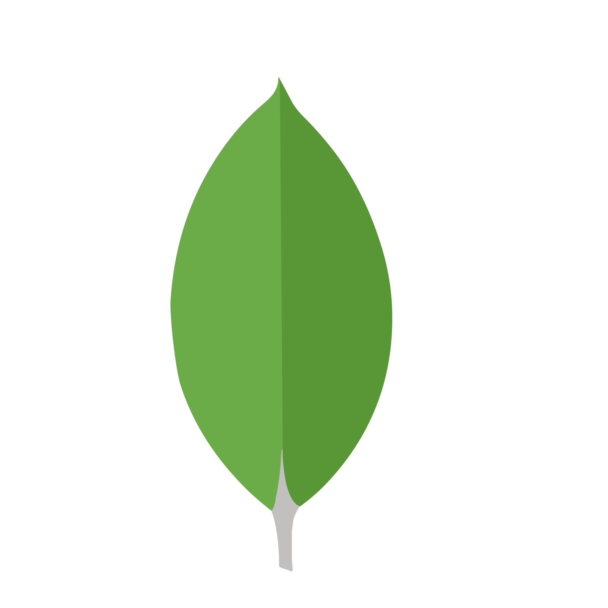
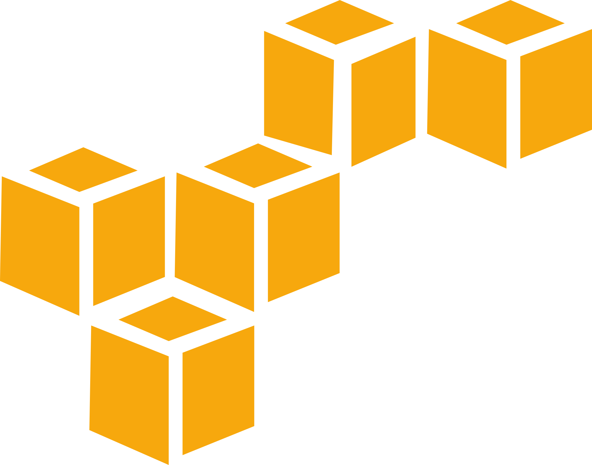

<h1 align="center">Jessie Tarrosa</h1>

  <b>Senior Full-Stack Engineer · React, Next.js, TypeScript, Node · AI-assisted development with Claude Code</b>
   
  Cebu, Philippines · open to remote contract and full-time work

  <a href="https://jessiet.dev">Portfolio</a> ·
  <a href="https://www.linkedin.com/in/jessiedev/">LinkedIn</a> ·
  <a href="https://drive.google.com/file/d/15SlHoyTbgKL_6MY576gk8CglH0AoDnnS/view?usp=sharing">3-minute product walkthrough</a> ·
  <a href="mailto:app.creator@jessiet.dev">app.creator@jessiet.dev</a>

## About

I have 9+ years building production web apps end to end: schema and APIs, React and Next.js front ends, CI/CD and AWS deploys. I turn complicated workflows into products that feel simple.

- **Atrium OS** (founder): multi-tenant property and rental management SaaS with automatic billing, official receipts, accounting, budgets, procurement and supplier bills. Next.js, tRPC, MongoDB, Tailwind, AWS.
- **Invenire and Invenire Review AI** (S2Data): records and document platform with AI-assisted review, full-text search and background jobs. Next.js, MongoDB, Elasticsearch, BullMQ, OpenAI.
- **Earlier:** Permission.io (fintech and web3), Accenture · Solution.AI (workforce analytics), Fuxam, and freelance clients.

## How I build

Claude Code is my main environment. I plan first, run parallel sub-agents that each own their own files, and nothing ships until the type check, linter and tests pass and I've reviewed the diff. The rules I work from are public: [CLAUDE.md](https://github.com/oreoseenoevil/oreoseenoevil.github.io/blob/master/CLAUDE.md) and [AGENTS.md](https://github.com/oreoseenoevil/oreoseenoevil.github.io/blob/master/AGENTS.md).

## Stack

  
  
  
  
  
  
  
  
  
  

  

